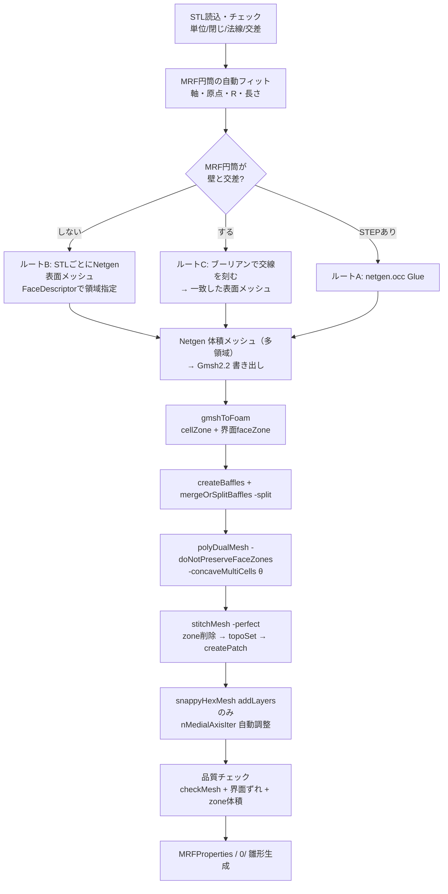

# OfPolyDualNavi 設計検討書

OpenFOAM（Keysight版 = openfoam.com 系列）の `polyDualMesh` を使って、MRF領域を持つポリヘドラルメッシュを作るためのGUIの検討。

- テトラメッシュ: Netgen
- レイヤー: snappyHexMesh（レイヤー追加だけを行う）
- 計算対象: 円筒で区切られたMRF領域を持つ。MRF領域はSTLで指定する

> 本書の「検証済」は、Ubuntu 24.04 の apt パッケージ **OpenFOAM v1912**（openfoam.com 系列）と **netgen-mesher 6.2.2608**（PyPI）で実際に動かした結果。
> Keysight 最新版（v25xx/v26xx）での再確認は Phase 0 で行う（コマンド名・オプションは同系列なので大きな差はないと見込むが、未確認）。
> 再現スクリプトは [`poc/`](../poc/) にある。

---

## 1. 結論（要約）

1. **工程は成立する。** STL → Netgen多領域テトラ → polyDualMesh → snappyのレイヤー追加 → MRF計算、まで一通り通り、`checkMesh` は `Mesh OK`、MRFの cellZone 体積は理論値と0.1%で一致した。
2. **MRF界面の扱いが成否を決める。** そのままでは次の3つの落とし穴がある。GUIが自動で回避すべき中心的な理由はここにある。

   | 落とし穴 | 何が起きるか（検証済） | 対策 |
   |---|---|---|
   | polyDualMesh の faceZone 保持（既定動作） | 界面上の全点が特徴点扱いになり、界面沿いに微小な六面体の帯ができて**セル数が約4倍**になる（7,936 → 31,217） | 界面をバッフル化して点を分割 → `-doNotPreserveFaceZones` でデュアル化 → `stitchMesh -perfect` で縫い戻す |
   | polyDualMesh 後の cellZone | セル番号のまま残るため**中身が無意味**になる（体積が全く合わない） | 削除して `topoSet` で作り直す（界面が円筒面に一致しているので、セル中心判定で正確に選べる） |
   | snappy のレイヤー追加 | メッシュを縮める変位が内部まで伝わり、**界面が最大でR方向3%、軸方向8%押し出される** | `nMedialAxisIter` で変位の伝播を制限する（8で界面のずれ1%以内、ハブのレイヤー厚は目標の91%） |

3. **最大の未解決リスク:** MRF円筒が壁（シャフトやケーシング）と**交差・接触**するケース。STLを結合すると非多様体になり、**Netgen の STL モジュールは失敗する**（検証済）。境界が一致した表面メッシュさえ用意できれば、Netgen の体積メッシュ生成自体は通ることも確認済み。この表面を誰がどう作るかを Phase 0 で決める（§3.3 ルートC）。

---

## 2. 推奨パイプライン



| # | 工程 | 実行するもの | 検証 |
|---|---|---|---|
| S0 | 形状の読込とチェック | trimesh（閉じているか、法線、非多様体、自己交差、単位） | 一部 |
| S1 | MRF円筒のフィット | 主成分分析＋最小二乗で軸・原点・R・長さを推定。理想円筒STLの再生成も可能にする | 未 |
| S2 | 交線の刻み込み（ルートC） | manifold3d のブーリアン（stator = 流体 − 円筒, rotor = 流体 ∩ 円筒） | 閉じた形状の生成のみ済 |
| S3 | テトラメッシュ | netgen-mesher（Python API） | 済（ルートB） |
| S4 | OpenFOAMへ変換 | 自前の Gmsh2.2 書き出し → `gmshToFoam` → パッチ種別の設定 | 済 |
| S5 | 界面のバッフル化 | `createBaffles` → `mergeOrSplitBaffles -split` | 済 |
| S6 | デュアル化 | `polyDualMesh -overwrite -doNotPreserveFaceZones -concaveMultiCells <角度>` | 済 |
| S7 | 縫合とゾーン再作成 | `stitchMesh -perfect` → zone削除 → `topoSet` → `createPatch` | 済 |
| S8 | レイヤー | `snappyHexMesh -overwrite`（castellated/snap は false） | 済 |
| S9 | 品質評価 | `checkMesh`、界面ずれ（`poc/foamreader.py`）、cellZone体積 | 済 |
| S10 | ケース設定 | `constant/MRFProperties`、`0/` の雛形 | 済（simpleFoam 200反復が発散せず回ることのみ） |

### 検証ケースの数値（`poc/run_pipeline.sh`、所要26秒）

形状: 外箱 0.4×0.4×0.6 m、MRF円筒 R=0.1 m・長さ0.15 m（完全に内部）、MRF内のハブ R=0.04 m・長さ0.08 m

| 段階 | セル数 | 備考 |
|---|---|---|
| Netgen テトラ | 40,057（点 7,936） | stator 29,618 / rotor 10,439、`Mesh OK` |
| polyDualMesh（faceZone保持＝既定） | 31,217 | うち六面体 24,560 ← 微小セルの帯。**不採用** |
| polyDualMesh（バッフル分割＋非保持） | 9,199 | = 点数 7,936 + 界面の点 1,263。理論どおり |
| 　〃 ＋ `-concaveMultiCells` | 11,583 | ハブ縁の凹エッジで +2,384。`Mesh OK`（付けないと面の向き不正が39個） |
| レイヤー追加後 | 20,489 | walls 3層（被覆60%、箱の90°角で止まる）、hub 4層（厚さ91%）、`Mesh OK` |

MRF cellZone の体積: テトラ 0.0043027 → デュアル 0.0043042 → レイヤー後 0.0043051（理論値 0.0043103）

**セル数の見積もり式**（GUIで事前表示する）:

```
N_poly ≈ N_tet点数 + N_界面の点数 + (凹エッジ分) + Σ(壁面の面数 × 層数 × 被覆率)
```

検証値: 11,583 + (2,649×2.14 + 809×4) = 20,488（実測 20,489）。テトラのセル数ではなく**点数**で決まる点に注意（テトラのセル数のおよそ1/5）。

---

## 3. 工程ごとの技術検討

### 3.1 形状入力（STL）

想定する入力:
- 流体領域の境界STL。パッチごとに分けたファイル、または ASCII STL の `solid` 名で区別（inlet / outlet / walls / impeller …）
- MRF円筒STL（複数可）
- 単位系（mm → m への換算）

GUIで行うチェック:
- 閉じているか、法線の向きが揃っているか、非多様体エッジ、自己交差
- MRF円筒と壁の交差判定（ルートの自動選択に使う）
- MRF円筒のフィット残差（円筒でなければ警告）。フィットで得た原点と軸は **MRFProperties と topoSet の両方に流用**し、値の食い違いを構造的になくす

### 3.2 MRF円筒

- STLのフィットで `origin / axis / R / 長さ` を得る
- 「理想円筒STLを再生成」オプション: CAD出力のSTLは細長い三角形が多く、Netgen の表面メッシュ品質が落ちるため
- 周方向の分割数は、界面の弦と円弧のずれ `R(1−cos(π/n))` が局所セルサイズより十分小さくなるように自動で決める
- 複数のMRF領域（MRF1, MRF2 …）に対応する。それぞれ別の Netgen 領域番号と cellZone を割り当てる

### 3.3 テトラメッシュ（Netgen）— 3つのルート

**ルートB（STL、MRF円筒が完全に内部）: 検証済**
- STLごとに Netgen STL モジュールで表面メッシュを作り（`perfstepsend=MESHSURFACE`）、1つの `Mesh` に組み立てる
- 各面の `FaceDescriptor(domin, domout)` で「どの領域とどの領域の間か」を指定して `GenerateVolumeMesh()`
  - 例: 外壁 `domin=1, domout=0`、MRF界面 `domin=2, domout=1`、MRF内の回転壁 `domin=0, domout=2`
- 界面の節点は両側で共有されるので、一致した界面になる（検証で領域体積も一致）
- 局所サイズは STL ごとの `maxh` と、必要なら `RestrictLocalH` で指定

**ルートC（STL、MRF円筒が壁と交差・接触）: 一部検証**
- 流体STLと円筒STLをそのまま結合すると、交線が3枚以上の面で共有される非多様体になる。**Netgen STL モジュールは `Get neighbourpoints failed` を出して `bad_alloc` で落ちた**
- ただし、境界が一致した非多様体の表面メッシュを直接渡せば、**Netgen の体積メッシュ生成は成功した**（stator / rotor の2領域）
- 必要な前処理:
  1. ブーリアンで交線を刻み込む（manifold3d で stator / rotor の閉じた形状が得られることは確認済み）
  2. **境界が一致した表面メッシュの再生成（未解決）**。候補:
     - (a) Gmsh の離散形状の分類（`classifySurfaces` → `createGeometry`）で表面メッシュだけを作り、体積は Netgen で生成
     - (b) 交線ごとに1次元分割を固定し、パッチ単位で Netgen 2D メッシュ化（自前実装）
     - (c) 体積メッシュも Gmsh で作り、Netgen のオプティマイザだけを使う
- **ルートCのPoCを Phase 0 の最優先課題とする**

**ルートA（STEPあり）: 未検証だが最も堅牢**
- `netgen.occ` で流体ソリッドと円筒ソリッド（GUIのフィット値から解析的に作れる）を `Glue` すると、交差があっても一致した多領域になる
- CAD が手に入るなら最優先で使う

**OpenFOAMへの変換**
- 自前の Gmsh 2.2 書き出し（`poc/ng2msh.py`）→ `gmshToFoam`
  - 物理ボリューム → **cellZone**、内部の物理サーフェス → **faceZone**（界面）、境界の物理サーフェス → パッチ
- 検証でつまずいた点:
  - Netgen 標準の Gmsh2 出力は物理タグの番号付けが当てにならない → 自前で書き出す
  - **Netgen と Gmsh ではテトラの頂点順が逆**。入れ替えないと全セルが負体積になる
  - `Mesh.SetBCName()` で余分な FaceDescriptor ができた → 名前は自前で管理する
  - `gmshToFoam` は全パッチを `patch` 型で出すので、`wall` への変更が必要（GUIでパッチ種別を指定）
  - 代替経路として `netgenNeutralToFoam` もあるが、パッチ名と領域情報が弱いので非推奨

### 3.4 界面の処理と polyDualMesh

**推奨手順（検証済）:**

```sh
createBaffles -overwrite                 # faceZone mrfInterface → パッチ mrfStator / mrfRotor
mergeOrSplitBaffles -split -overwrite    # 界面の点を両側で分割
polyDualMesh -overwrite -doNotPreserveFaceZones -concaveMultiCells 60
stitchMesh -perfect -overwrite mrfStator mrfRotor
rm constant/polyMesh/{cellZones,faceZones,pointZones}
topoSet                                  # cellZone rotor を作り直す
createPatch -overwrite                   # 空パッチの削除
```

理由:
- 界面を境界パッチにすると、デュアル化で界面上の点のセルが境界でクリップされ、**界面が元の三角形分割どおりの位置に残る**。両側の三角形分割が同じなので、デュアル後の界面の面も一致し、`stitchMesh -perfect` で縫い戻せる
- `createBaffles` 自身が faceZone を作るため、`-doNotPreserveFaceZones` を付けないと、faceZone 保持（セル数4倍）が再発する（実際に再発した）
- `stitchMesh` は「点が両側のパッチから使われている」という警告を出すが、結果は `Mesh OK`。界面が壁と接するケースでの挙動は未確認（Phase 0）

**polyDualMesh のパラメータ（GUIで設定）:**
- `featureAngle`（必須の引数）: 境界の折れ角がこれを超えるエッジを特徴線として保持する。既定は 60°
- `-concaveMultiCells`: 凹エッジ上の点を複数セルに分ける。付けないと面の向き不正が出たので**既定でON**
- `-splitAllFaces`: 通常はOFF
- 並列実行は不可（シリアル）。大規模メッシュではメモリと時間の見積もりを表示する

### 3.5 レイヤー（snappyHexMesh のレイヤー追加のみ）

```
castellatedMesh false; snap false; addLayers true;
geometry {}
castellatedMeshControls { ...ダミー... }   // 使わないが辞書は必要
snapControls { ...ダミー... }
addLayersControls { relativeSizes false; firstLayerThickness ...; expansionRatio ...; nMedialAxisIter 8; ... }
```

- **`relativeSizes false`（絶対値指定）を既定にする**。snappy の相対指定は hexRef8 の基準セル長が前提で、ポリヘドラルメッシュでは基準が不明確なため
- y+ 計算機（U, L, ν, 目標 y+ → 第1層の厚さ）をGUIに入れる
- **MRF界面の変形対策**:
  - 制限なし: 界面のずれは R方向 最大3%、軸方向 最大8%
  - `nMedialAxisIter`: 2 / 4 / 8 / 16 で比較。**8 で界面のずれ1%以内、ハブ厚91%**。16 では制限なしとほぼ同じ
  - GUIでは「レイヤーを付ける壁と界面の距離（セル数）」から初期値を提案し、レイヤー追加後に**界面のずれ指標を自動で報告**する
  - 試して不採用にした方法:
    - バッフルのままレイヤー追加 → 縫合: 界面の点がわずかに滑り（0.2 mm）`-perfect` 縫合が失敗、`-integral` は異常終了
    - 界面の点を円筒へ単純に投影: 負体積セルが22個発生
- 箱の90°の角では被覆率が落ちる（walls 60%）。`featureAngle`、`nGrow`、`nRelaxIter` などの調整項目を「詳細設定」として出す
- 前工程が `0/` に書いた `meshPhi` などが残っていると snappy が落ちる → **各工程の前に `0/` を掃除**
- 並列実行可（`decomposePar` → `-parallel` → `reconstructParMesh -constant`）。ただし zone の扱いは要確認

### 3.6 品質チェック

- `checkMesh -allGeometry -allTopology` のログを解析し、非直交性・歪度・凹面・アスペクト比を表で表示
- `-writeSets` → `foamToVTK -cellSet` で悪いセルを3D表示
- MRF固有のチェック:
  - cellZone の体積と理論値（円筒 − 内部の固体）の比較
  - 界面のずれ（`poc/foamreader.py interface_deviation`）
  - cellZone が1つの連結領域で、界面が閉じているか

### 3.7 MRFProperties（openfoam.com 形式）

```
MRF1
{
    cellZone    rotor;
    active      yes;
    nonRotatingPatches ();   // MRF内の静止壁
    origin      (0 0 0);     // S1 のフィット値
    axis        (0 0 1);
    omega       104.72;      // GUIでは rpm 入力 → rad/s に換算
}
```

- MRF内の回転壁は `fixedValue (0 0 0)` を置いておけば MRF が回転速度に置き換える
- 計算の収束性・妥当性は本検討の範囲外（PoCでは層流で200反復が発散しないことのみ確認）

---

## 4. GUI 設計

### 4.1 技術スタック（案）

| 層 | 候補 | 理由 |
|---|---|---|
| GUI | Python 3.11+ / PySide6 (Qt) | デスクトップ向け、ライセンスがLGPL |
| 3D表示 | PyVista + pyvistaqt (VTK) | STL・メッシュ・zone・悪いセルの表示 |
| 形状処理 | trimesh, manifold3d, numpy/scipy | チェック、円筒フィット、ブーリアン |
| テトラ | netgen-mesher（PyPI wheel、Windows/Linux/macOS） | Python API で多領域指定ができる |
| 辞書生成 | Jinja2 テンプレート | バージョン差をテンプレートで吸収 |
| 実行 | subprocess（ローカル Linux / WSL / Docker） | Keysight版の Windows 提供形態（WSL・Docker）に合わせる |

Windows の場合: GUI と Netgen は Windows ネイティブ、OpenFOAM は `wsl -d <distro> bash -lc "source <bashrc> && ..."` で呼び出す。ケースは WSL 側のファイルシステムに置く（I/O速度のため）。

### 4.2 画面構成（ウィザード ＋ 工程ごとの再実行）

1. **プロジェクト / 環境**: OpenFOAM の bashrc パス、バージョンプロファイル、実行方式、並列数
2. **形状**: STL取込、パッチ名と種別（wall/patch/…）、単位、チェック結果、3D表示
3. **MRF領域**: 円筒のフィット結果（軸・原点・R・長さを3Dに重ねて表示）、回転数、静止壁の指定、ルートの自動判定
4. **テトラ**: 全体と局所の maxh、grading、最適化回数、**ポリセル数の見積もり**、プレビュー
5. **デュアル化**: featureAngle、concaveMultiCells などのオプション、結果の統計
6. **レイヤー**: パッチごとの層数・第1層厚・成長率、y+ 計算機、nMedialAxisIter（自動提案）
7. **品質レポート**: checkMesh の表、悪いセルの表示、MRF界面のずれ・zone体積、合否の判定
8. **出力**: MRFProperties、`0/` の雛形、実行スクリプト（GUIなしでも再現できる `Allmesh`）

### 4.3 アーキテクチャ

```
ofpolydualnavi/
  core/
    project.py      # プロジェクト設定 (pydantic) ⇔ project.yaml
    pipeline.py     # 工程 DAG・状態 (未実行/実行中/完了/失敗/要再実行)・入力ハッシュ
    runner.py       # OpenFOAM 実行抽象 (Local / WSL / Docker)、ログのストリーミング
    geometry.py     # STLチェック、円筒フィット、ブーリアン
    netgen_mesh.py  # 多領域テトラ (poc/netgen_multidomain.py を発展)
    foam_io.py      # polyMesh リーダ、checkMesh ログの解析 (poc/foamreader.py を発展)
    templates/      # Jinja2: createBafflesDict, topoSetDict, snappyHexMeshDict, MRFProperties ...
    profiles/       # v1912 / v2406 / v2512 ... のテンプレート差分
  gui/              # PySide6 の画面
  cli.py            # GUI なしでも project.yaml から全工程を実行できる
```

- **すべての設定を `project.yaml` に保存**し、GUIはそれを編集するだけにする。CLI からも同じ工程を回せるようにして、再現性とバッチ実行を確保する
- 工程ごとに入力のハッシュを持ち、上流が変わったら下流を「要再実行」にする
- 工程の前に `0/` を掃除し、各工程の `polyMesh` をスナップショットとして保存する（やり直しとレビューのため）
- ログは工程ごとに保存し、GUIではリアルタイムに表示する。既知のエラーには対処のヒントを出す（例: 負体積 → 頂点順、セル数の急増 → faceZone 保持）

---

## 5. ロードマップ（案）

| フェーズ | 内容 | 完了条件 |
|---|---|---|
| **Phase 0: PoC 補完** | ①**ルートC**（MRF円筒が壁と交差）の表面メッシュ生成を決める ②Keysight 最新版で `poc/run_pipeline.sh` を再確認 ③界面が壁と接する場合の stitch とレイヤー ④実形状（羽根車）での確認 | 実形状で `Mesh OK`、界面のずれ1%以内 |
| Phase 1: CLI コア | `project.yaml` → 全工程を実行する CLI、テンプレート、品質レポート（HTML） | GUIなしで実形状を通せる |
| Phase 2: GUI MVP | 画面 2〜7、3D表示、ログ表示、工程の再実行 | 1ケースをGUIだけで完了できる |
| Phase 3: 実用化 | 複数MRF、並列実行、WSL/Docker、セル数の見積もり、パラメータの自動調整 | 社内ケースでの試用 |

---

## 6. 確認したい事項

1. **MRF円筒は壁（シャフト・ハブ・ケーシング）と交差・接触しますか？**（ルートB/Cの選択。最重要）
2. 元の CAD（STEP）は入手できますか？（できればルートAが最も堅牢）
3. 実行環境: Windows + WSL / Linux / Docker のどれか。Keysight 版のバージョン（v2506 / v2512 など）
4. 想定セル数の規模（数十万／数百万／数千万）と並列実行の必要性
5. GUI の技術選定（Python + Qt で問題ないか）、利用者は1人か複数人か
6. MRF領域の数（1つか複数か）と、静止壁（nonRotatingPatches）の有無
