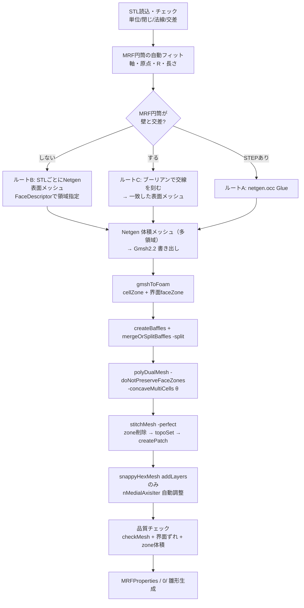

# OfPolyDualNavi 設計検討書

> 対象バージョン: `0.1.0.dev0`（開発中）

OpenFOAM（Keysight版 = openfoam.com 系列）の `polyDualMesh` を使って、MRF領域を持つポリヘドラルメッシュを作るためのGUIの検討。

- テトラメッシュ: Netgen
- レイヤー: snappyHexMesh（レイヤー追加だけを行う）
- 計算対象: 円筒で区切られたMRF領域を持つ。MRF領域はSTLで指定する

> 本書の「検証済」は、Ubuntu 24.04 の apt パッケージ **OpenFOAM v1912**（openfoam.com 系列）と **netgen-mesher 6.2.2608**（PyPI）で実際に動かした結果。
> Keysight 最新版（v25xx/v26xx）での再確認は Phase 0 で行う（コマンド名・オプションは同系列なので大きな差はないと見込むが、未確認）。
> 再現スクリプトは [`poc/`](../poc/) にある。

---

## 1. 結論（要約）

1. **工程は成立する。** STL → Netgen多領域テトラ → polyDualMesh → snappyのレイヤー追加 → MRF計算、まで一通り通り、`checkMesh` は `Mesh OK`、MRFの cellZone 体積は理論値と0.1%で一致した。
2. **MRF界面の扱いが成否を決める。** そのままでは次の3つの落とし穴がある。GUIが自動で回避すべき中心的な理由はここにある。

   | 落とし穴 | 何が起きるか（検証済） | 対策 |
   |---|---|---|
   | polyDualMesh の faceZone 保持（既定動作） | 界面上の全点が特徴点扱いになり、界面沿いに微小な六面体の帯ができて**セル数が約4倍**になる（7,936 → 31,217） | 界面をバッフル化して点を分割 → `-doNotPreserveFaceZones` でデュアル化 → `stitchMesh -perfect` で縫い戻す |
   | polyDualMesh 後の cellZone | セル番号のまま残るため**中身が無意味**になる（体積が全く合わない） | 削除して `topoSet` で作り直す（界面が円筒面に一致しているので、セル中心判定で正確に選べる） |
   | snappy のレイヤー追加 | メッシュを縮める変位が内部まで伝わり、**界面が最大でR方向3%、軸方向8%押し出される** | `nMedialAxisIter` で変位の伝播を制限する（8で界面のずれ1%以内、ハブのレイヤー厚は目標の91%） |

3. **MRF円筒が壁と交差するケース（モータ回転子）は、STEP を使うルートAで解決した。** STL を結合すると非多様体になり Netgen の STL モジュールは失敗するが、GUI はユーザーの PC で STEP を読めるので、netgen.occ で界面を共有した多領域メッシュを作れる。シャフトが MRF円筒を貫くモータ風形状で、縫合まで含めて `Mesh OK` を確認した（§6.1）。
4. **エアギャップは「軸方向の押し出し」で作る（AMI なし）。** ギャップ中央で切ると、等方メッシュでは (a) 界面のセルがレイヤーで潰れる（§6.2）、(b) 実機の 0.5 mm 程度のギャップで1000万セルを超えうる（§6.3）。ギャップの円環を Netgen から除外し、両端を周期境界で同一分割にしてデュアル化後に押し出すと、上下とも完全一致で縫合でき、セル数は等方の 1/10 以下になった（§6.3、検証済）。

---

## 2. 推奨パイプライン



| # | 工程 | 実行するもの | 検証 |
|---|---|---|---|
| S0 | 形状の読込とチェック | trimesh（閉じているか、法線、非多様体、自己交差、単位） | 一部 |
| S1 | MRF円筒のフィット | 主成分分析＋最小二乗で軸・原点・R・長さを推定。理想円筒STLの再生成も可能にする | 未 |
| S2 | 交線の刻み込み（ルートC） | manifold3d のブーリアン（stator = 流体 − 円筒, rotor = 流体 ∩ 円筒） | 閉じた形状の生成のみ済 |
| S3 | テトラメッシュ | netgen-mesher（Python API） | 済（ルートB） |
| S4 | OpenFOAMへ変換 | 自前の Gmsh2.2 書き出し → `gmshToFoam` → パッチ種別の設定 | 済 |
| S5 | 界面のバッフル化 | `createBaffles` → `mergeOrSplitBaffles -split` | 済 |
| S6 | デュアル化 | `polyDualMesh -overwrite -doNotPreserveFaceZones -concaveMultiCells <角度>` | 済 |
| S7 | 縫合とゾーン再作成 | `stitchMesh -perfect` → zone削除 → `topoSet` → `createPatch` | 済 |
| S8 | レイヤー | `snappyHexMesh -overwrite`（castellated/snap は false） | 済 |
| S9 | 品質評価 | `checkMesh`、界面ずれ（`poc/foamreader.py`）、cellZone体積 | 済 |
| S10 | ケース設定 | `constant/MRFProperties`、`0/` の雛形 | 済（simpleFoam 200反復が発散せず回ることのみ） |

### 検証ケースの数値（`poc/run_pipeline.sh`、所要26秒）

形状: 外箱 0.4×0.4×0.6 m、MRF円筒 R=0.1 m・長さ0.15 m（完全に内部）、MRF内のハブ R=0.04 m・長さ0.08 m

| 段階 | セル数 | 備考 |
|---|---|---|
| Netgen テトラ | 40,057（点 7,936） | stator 29,618 / rotor 10,439、`Mesh OK` |
| polyDualMesh（faceZone保持＝既定） | 31,217 | うち六面体 24,560 ← 微小セルの帯。**不採用** |
| polyDualMesh（バッフル分割＋非保持） | 9,199 | = 点数 7,936 + 界面の点 1,263。理論どおり |
| 　〃 ＋ `-concaveMultiCells` | 11,583 | ハブ縁の凹エッジで +2,384。`Mesh OK`（付けないと面の向き不正が39個） |
| レイヤー追加後 | 20,489 | walls 3層（被覆60%、箱の90°角で止まる）、hub 4層（厚さ91%）、`Mesh OK` |

MRF cellZone の体積: テトラ 0.0043027 → デュアル 0.0043042 → レイヤー後 0.0043051（理論値 0.0043103）

**セル数の見積もり式**（GUIで事前表示する）:

```
N_poly ≈ N_tet点数 + N_界面の点数 + (凹エッジ分) + Σ(壁面の面数 × 層数 × 被覆率)
```

検証値: 11,583 + (2,649×2.14 + 809×4) = 20,488（実測 20,489）。テトラのセル数ではなく**点数**で決まる点に注意（テトラのセル数のおよそ1/5）。

---

## 3. 工程ごとの技術検討

### 3.1 形状入力（STL）

想定する入力:
- 流体領域の境界STL。パッチごとに分けたファイル、または ASCII STL の `solid` 名で区別（inlet / outlet / walls / impeller …）
- MRF円筒STL（複数可）
- 単位系（mm → m への換算）

GUIで行うチェック:
- 閉じているか、法線の向きが揃っているか、非多様体エッジ、自己交差
- MRF円筒と壁の交差判定（ルートの自動選択に使う）
- MRF円筒のフィット残差（円筒でなければ警告）。フィットで得た原点と軸は **MRFProperties と topoSet の両方に流用**し、値の食い違いを構造的になくす

### 3.2 MRF円筒

- STLのフィットで `origin / axis / R / 長さ` を得る
- 「理想円筒STLを再生成」オプション: CAD出力のSTLは細長い三角形が多く、Netgen の表面メッシュ品質が落ちるため
- 周方向の分割数は、界面の弦と円弧のずれ `R(1−cos(π/n))` が局所セルサイズより十分小さくなるように自動で決める
- 複数のMRF領域（MRF1, MRF2 …）に対応する。それぞれ別の Netgen 領域番号と cellZone を割り当てる

### 3.3 テトラメッシュ（Netgen）— 3つのルート

**ルートB（STL、MRF円筒が完全に内部）: 検証済**
- STLごとに Netgen STL モジュールで表面メッシュを作り（`perfstepsend=MESHSURFACE`）、1つの `Mesh` に組み立てる
- 各面の `FaceDescriptor(domin, domout)` で「どの領域とどの領域の間か」を指定して `GenerateVolumeMesh()`
  - 例: 外壁 `domin=1, domout=0`、MRF界面 `domin=2, domout=1`、MRF内の回転壁 `domin=0, domout=2`
- 界面の節点は両側で共有されるので、一致した界面になる（検証で領域体積も一致）
- 局所サイズは STL ごとの `maxh` と、必要なら `RestrictLocalH` で指定

**ルートC（STL、MRF円筒が壁と交差・接触）: 一部検証**
- 流体STLと円筒STLをそのまま結合すると、交線が3枚以上の面で共有される非多様体になる。**Netgen STL モジュールは `Get neighbourpoints failed` を出して `bad_alloc` で落ちた**
- ただし、境界が一致した非多様体の表面メッシュを直接渡せば、**Netgen の体積メッシュ生成は成功した**（stator / rotor の2領域）
- 必要な前処理:
  1. ブーリアンで交線を刻み込む（manifold3d で stator / rotor の閉じた形状が得られることは確認済み）
  2. **境界が一致した表面メッシュの再生成（未解決）**。候補:
     - (a) Gmsh の離散形状の分類（`classifySurfaces` → `createGeometry`）で表面メッシュだけを作り、体積は Netgen で生成
     - (b) 交線ごとに1次元分割を固定し、パッチ単位で Netgen 2D メッシュ化（自前実装）
     - (c) 体積メッシュも Gmsh で作り、Netgen のオプティマイザだけを使う
- **ルートCのPoCを Phase 0 の最優先課題とする**

**ルートA（STEPあり）: 未検証だが最も堅牢**
- `netgen.occ` で流体ソリッドと円筒ソリッド（GUIのフィット値から解析的に作れる）を `Glue` すると、交差があっても一致した多領域になる
- CAD が手に入るなら最優先で使う

**OpenFOAMへの変換**
- 自前の Gmsh 2.2 書き出し（`poc/ng2msh.py`）→ `gmshToFoam`
  - 物理ボリューム → **cellZone**、内部の物理サーフェス → **faceZone**（界面）、境界の物理サーフェス → パッチ
- 検証でつまずいた点:
  - Netgen 標準の Gmsh2 出力は物理タグの番号付けが当てにならない → 自前で書き出す
  - **Netgen と Gmsh ではテトラの頂点順が逆**。入れ替えないと全セルが負体積になる
  - `Mesh.SetBCName()` で余分な FaceDescriptor ができた → 名前は自前で管理する
  - `gmshToFoam` は全パッチを `patch` 型で出すので、`wall` への変更が必要（GUIでパッチ種別を指定）
  - 代替経路として `netgenNeutralToFoam` もあるが、パッチ名と領域情報が弱いので非推奨

### 3.4 界面の処理と polyDualMesh

**推奨手順（検証済）:**

```sh
createBaffles -overwrite                 # faceZone mrfInterface → パッチ mrfStator / mrfRotor
mergeOrSplitBaffles -split -overwrite    # 界面の点を両側で分割
polyDualMesh -overwrite -doNotPreserveFaceZones -concaveMultiCells 60
stitchMesh -perfect -overwrite mrfStator mrfRotor
rm constant/polyMesh/{cellZones,faceZones,pointZones}
topoSet                                  # cellZone rotor を作り直す
createPatch -overwrite                   # 空パッチの削除
```

理由:
- 界面を境界パッチにすると、デュアル化で界面上の点のセルが境界でクリップされ、**界面が元の三角形分割どおりの位置に残る**。両側の三角形分割が同じなので、デュアル後の界面の面も一致し、`stitchMesh -perfect` で縫い戻せる
- `createBaffles` 自身が faceZone を作るため、`-doNotPreserveFaceZones` を付けないと、faceZone 保持（セル数4倍）が再発する（実際に再発した）
- `stitchMesh` は「点が両側のパッチから使われている」という警告を出すが、結果は `Mesh OK`。界面が壁と接するケースでの挙動は未確認（Phase 0）

**polyDualMesh のパラメータ（GUIで設定）:**
- `featureAngle`（必須の引数）: 境界の折れ角がこれを超えるエッジを特徴線として保持する。既定は 60°
- `-concaveMultiCells`: 凹エッジ上の点を複数セルに分ける。付けないと面の向き不正が出たので**既定でON**
- `-splitAllFaces`: 通常はOFF
- 並列実行は不可（シリアル）。大規模メッシュではメモリと時間の見積もりを表示する

### 3.5 レイヤー（snappyHexMesh のレイヤー追加のみ）

```
castellatedMesh false; snap false; addLayers true;
geometry {}
castellatedMeshControls { ...ダミー... }   // 使わないが辞書は必要
snapControls { ...ダミー... }
addLayersControls { relativeSizes false; firstLayerThickness ...; expansionRatio ...; nMedialAxisIter 8; ... }
```

- **`relativeSizes false`（絶対値指定）を既定にする**。snappy の相対指定は hexRef8 の基準セル長が前提で、ポリヘドラルメッシュでは基準が不明確なため
- y+ 計算機（U, L, ν, 目標 y+ → 第1層の厚さ）をGUIに入れる
- **MRF界面にはレイヤーを入れない**（ユーザー要件）。GUI で次を保証する:
  1. 界面（内部の faceZone）はレイヤー設定の対象に出さない。パッチ名の正規表現が界面に当たる場合はエラーにする
  2. 壁からの縮小変位が界面まで届かないよう `nMedialAxisIter` を制限する
  3. レイヤー追加後に、界面のずれと界面に接するセルの厚さを自動で検査し、基準を超えたら警告する
- 壁とMRF領域を名前で取り違えないよう、パッチは `rotorCore` / `statorCore`、cellZone は `MRF_rotor` のように命名する
- **MRF界面の変形対策**:
  - 制限なし: 界面のずれは R方向 最大3%、軸方向 最大8%
  - `nMedialAxisIter`: 2 / 4 / 8 / 16 で比較。**8 で界面のずれ1%以内、ハブ厚91%**。16 では制限なしとほぼ同じ
  - GUIでは「レイヤーを付ける壁と界面の距離（セル数）」から初期値を提案し、レイヤー追加後に**界面のずれ指標を自動で報告**する
  - 試して不採用にした方法:
    - バッフルのままレイヤー追加 → 縫合: 界面の点がわずかに滑り（0.2 mm）`-perfect` 縫合が失敗、`-integral` は異常終了
    - 界面の点を円筒へ単純に投影: 負体積セルが22個発生
- 箱の90°の角では被覆率が落ちる（walls 60%）。`featureAngle`、`nGrow`、`nRelaxIter` などの調整項目を「詳細設定」として出す
- 前工程が `0/` に書いた `meshPhi` などが残っていると snappy が落ちる → **各工程の前に `0/` を掃除**
- 並列実行可（`decomposePar` → `-parallel` → `reconstructParMesh -constant`）。ただし zone の扱いは要確認

### 3.6 品質チェック

- `checkMesh -allGeometry -allTopology` のログを解析し、非直交性・歪度・凹面・アスペクト比を表で表示
- `-writeSets` → `foamToVTK -cellSet` で悪いセルを3D表示
- MRF固有のチェック:
  - cellZone の体積と理論値（円筒 − 内部の固体）の比較
  - 界面のずれ（`poc/foamreader.py interface_deviation`）
  - cellZone が1つの連結領域で、界面が閉じているか

### 3.7 MRFProperties（openfoam.com 形式）

```
MRF1
{
    cellZone    rotor;
    active      yes;
    nonRotatingPatches ();   // MRF内の静止壁
    origin      (0 0 0);     // S1 のフィット値
    axis        (0 0 1);
    omega       104.72;      // GUIでは rpm 入力 → rad/s に換算
}
```

- MRF内の回転壁は `fixedValue (0 0 0)` を置いておけば MRF が回転速度に置き換える
- 計算の収束性・妥当性は本検討の範囲外（PoCでは層流で200反復が発散しないことのみ確認）

---

## 4. GUI 設計

### 4.1 技術スタック（案）

| 層 | 候補 | 理由 |
|---|---|---|
| GUI | Python 3.11+ / PySide6 (Qt) | デスクトップ向け、ライセンスがLGPL |
| 3D表示 | PyVista + pyvistaqt (VTK) | STL・メッシュ・zone・悪いセルの表示 |
| 形状処理 | trimesh, manifold3d, numpy/scipy | チェック、円筒フィット、ブーリアン |
| テトラ | netgen-mesher（PyPI wheel、Windows/Linux/macOS） | Python API で多領域指定ができる |
| 辞書生成 | Jinja2 テンプレート | バージョン差をテンプレートで吸収 |
| 実行 | subprocess（ローカル Linux / WSL / Docker） | Keysight版の Windows 提供形態（WSL・Docker）に合わせる |

**実行環境は WSL に決定**。MVP では GUI・Netgen・OpenFOAM をすべて WSL（Ubuntu）内で動かし、画面は WSLg で表示する。
- 理由: Python 環境が1つで済み、パスの変換（`C:\` ⇔ `/mnt/c`）が要らない。netgen-mesher（OCC入り）も Linux 版 wheel で入る
- ケースは WSL 側の ext4（`~/` 以下）に置く。`/mnt/c` 上は I/O が極端に遅い
- STEP は Windows 側から `/mnt/c/...` で読み込むか、GUI のファイル選択で WSL 側にコピーする
- WSL のメモリ上限は既定で物理メモリの50%。大規模メッシュでは `%UserProfile%\.wslconfig` の `memory=` と `swap=` を引き上げる必要がある（§6.8）。GUI で上限を検出して警告する
- 起動は Windows のショートカット（`wsl.exe -e ofpolydualnavi`）で行えるようにする
- 将来、Windows ネイティブ GUI から `wsl -d <distro> bash -lc "source <bashrc> && ..."` で呼び出す構成にも変えられるよう、実行部は抽象化しておく

### 4.2 画面構成（ウィザード ＋ 工程ごとの再実行）

1. **プロジェクト / 環境**: OpenFOAM の bashrc パス、バージョンプロファイル、実行方式、並列数
2. **形状**: STL取込、パッチ名と種別（wall/patch/…）、単位、チェック結果、3D表示
3. **MRF領域**: 円筒のフィット結果（軸・原点・R・長さを3Dに重ねて表示）、回転数、静止壁の指定、ルートの自動判定
4. **テトラ**: 全体と局所の maxh、grading、最適化回数、**ポリセル数の見積もり**、プレビュー
5. **デュアル化**: featureAngle、concaveMultiCells などのオプション、結果の統計
6. **レイヤー**: パッチごとの層数・第1層厚・成長率、y+ 計算機、nMedialAxisIter（自動提案）
7. **品質レポート**: checkMesh の表、悪いセルの表示、MRF界面のずれ・zone体積、合否の判定
8. **出力**: MRFProperties、`0/` の雛形、実行スクリプト（GUIなしでも再現できる `Allmesh`）

### 4.3 アーキテクチャ

```
ofpolydualnavi/
  core/
    project.py      # プロジェクト設定 (pydantic) ⇔ project.yaml
    pipeline.py     # 工程 DAG・状態 (未実行/実行中/完了/失敗/要再実行)・入力ハッシュ
    runner.py       # OpenFOAM 実行抽象 (Local / WSL / Docker)、ログのストリーミング
    geometry.py     # STLチェック、円筒フィット、ブーリアン
    netgen_mesh.py  # 多領域テトラ (poc/netgen_multidomain.py を発展)
    foam_io.py      # polyMesh リーダ、checkMesh ログの解析 (poc/foamreader.py を発展)
    templates/      # Jinja2: createBafflesDict, topoSetDict, snappyHexMeshDict, MRFProperties ...
    profiles/       # v1912 / v2406 / v2512 ... のテンプレート差分
  gui/              # PySide6 の画面
  cli.py            # GUI なしでも project.yaml から全工程を実行できる
```

- **すべての設定を `project.yaml` に保存**し、GUIはそれを編集するだけにする。CLI からも同じ工程を回せるようにして、再現性とバッチ実行を確保する
- 工程ごとに入力のハッシュを持ち、上流が変わったら下流を「要再実行」にする
- 工程の前に `0/` を掃除し、各工程の `polyMesh` をスナップショットとして保存する（やり直しとレビューのため）
- ログは工程ごとに保存し、GUIではリアルタイムに表示する。既知のエラーには対処のヒントを出す（例: 負体積 → 頂点順、セル数の急増 → faceZone 保持）

---

## 5. ロードマップ（案）

| フェーズ | 内容 | 完了条件 |
|---|---|---|
| **Phase 0: PoC 補完** | ①~~界面が壁と交差するケース~~（ルートAで解決） ②~~ギャップの扱い~~（軸方向押し出しで解決、§6.3） ②' ステータ外径の角の不正面（§6.4） ③Keysight 最新版（WSL）で `poc/run_pipeline.sh` と `poc/run_motor.sh` を再確認 ④ユーザーの実モータ STEP で確認（ローカルで実行） | 実形状で `Mesh OK`、界面のずれ1%以内、1000万セル以下 |
| Phase 1: CLI コア | `project.yaml` → 全工程を実行する CLI、テンプレート、品質レポート（HTML） | GUIなしで実形状を通せる |
| Phase 2: GUI MVP | 画面 2〜7、3D表示、ログ表示、工程の再実行 | 1ケースをGUIだけで完了できる |
| Phase 3: 実用化 | 複数MRF、並列実行、WSL/Docker、セル数の見積もり、パラメータの自動調整 | 社内ケースでの試用 |

---

## 6. モータ回転子のMRF（ギャップ中央で分割）への適用

前提（ユーザー回答, 2026-11-26）:
- MRF円筒は**シャフトなどの壁と交差する**（モータの回転子）
- MRF界面は**エアギャップの中央**に置く
- CAD（STEP）は**ユーザーのローカルでのみ**扱える → GUI がローカル（WSL）で STEP を読む
- 実行環境は **WSL**
- セル数は **1000万以下、少ないほど良い**

### 6.1 ルートA（STEP + netgen.occ）を主経路にする: 検証済

CAD をこちらに渡せなくても、GUI 自体がユーザーの PC で動くので、ルートA を主経路にできる。STL だけの場合はルートC（§3.3）を予備とする。

検証用に、部品ごとの STEP（ハウジング空洞・ステータコア・ロータコア・シャフト）でモータ風の形状を作った（`poc/make_motor_steps.py`）。
- ロータ R=40 mm、ギャップ 2 mm、コア長 80 mm、シャフト R=10 mm はハウジング端面まで貫通
- MRF円筒は R=41 mm（ギャップ中央）、長さ 90 mm（コア端から各 5 mm はみ出す）→ **シャフトが円筒の両端面と交差**

処理（`poc/occ_multidomain.py`）:
- 流体 = 空洞 − 固体部品。MRF円筒で rotor = 流体 ∩ 円筒、stator = 流体 − 円筒 に分け、`Glue` で界面を共有させる
- パッチ名は部品名（STEP ファイル名）がそのまま引き継がれる → GUI でのパッチ割当の手間が減る
- 界面は「2つの領域の間にある面」として自動判定（`domin>0` かつ `domout>0`）

結果（ギャップ部 maxh 0.8 mm、その他 8 mm）:

| 段階 | セル数 | 時間 / 最大メモリ | 備考 |
|---|---|---|---|
| Netgen テトラ | 1,889,569（点 415,179） | 290 s | stator 1,438,421 / rotor 451,148 |
| gmshToFoam | 同上 | 19 s / 1.4 GB | `Mesh OK` |
| createBaffles + split | | 24 s / 1.2 GB | |
| polyDualMesh | 516,252 | 30 s / 2.4 GB | |
| stitchMesh + topoSet | 516,252 | 17 s / 1.5 GB | `Mesh OK`。**シャフトと界面の交線部も縫合できた** |
| snappy レイヤー（全壁3層） | 1,107,269 | 132〜152 s / 3.9 GB | 界面のずれ 0.2%。ただし **面の向き不正 38 個**（§6.2） |

- MRF cellZone の体積: 7.0056e-5 m³（理論値 7.0026e-5、差 0.04%）、界面のずれは 0.01%
- 交差ありでも「バッフル化 → デュアル → 縫合 → topoSet」の手順はそのまま使える

### 6.2 ギャップ内の界面のセル潰れ

ギャップ中央に界面があると、半ギャップ（この例で 1 mm）にポリセルが1個程度しか入らない。ロータ側とステータ側の両方からレイヤーを入れると、界面のセルが両側から押されて、**向きの不正な面が38個**出た（全て r=41 mm の界面上）。`meshQualityDict` の `minTetQuality` を有効にしても消えなかった。

**原因**: デュアル化した時点で、界面のステータ側に薄いセル（最薄 0.12 mm、半ギャップ 1 mm に対して）が混じっている。レイヤー追加でこれが 0.04 mm まで押し潰され、面の向きが反転する。根本は「半ギャップにポリセルが1個程度しか入らない粗さ」。MRF界面そのものにはレイヤーは入っていない（界面は内部の faceZone なのでレイヤーの対象外）。

**レイヤー設定の比較**（ギャップ部 maxh 0.8 mm のデュアルメッシュ 51.6万セルに、全壁3層・第1層 0.1 mm）:

| 設定 | checkMesh | 層の厚さ（目標比）<br>ロータ / ステータ | 界面のずれ | snappy 時間 |
|---|---|---|---|---|
| 基準（`nMedialAxisIter 8`） | 向き不正 38 | 66% / 87% | 0.2% | 2.5 分 |
| `maxThicknessToMedialRatio 0.1` | 向き不正 38 | 58% / 61% | 0.2% | 3 分 |
| **`nMedialAxisIter 2`** | **Mesh OK** | 49% / 48% | **0.01%** | 15 分 |
| 第1層 0.2 mm・成長率 1.0 | Mesh OK | 59% / 73% | 0.25% | 17 分 |

- 縮小変位を壁の近くだけに留める（`nMedialAxisIter` を小さくする）と、界面は実質動かず `Mesh OK` になる。代わりにギャップ内の層は目標の半分程度の厚さになり、層追加の反復が増えて時間が延びる
- 層の厚さを減らすだけ（`maxThicknessToMedialRatio`）では解消しない

**ギャップを細かくした場合**（ギャップ部 maxh 0.4 mm、半ギャップに約2.5セル）:

| 工程 | 規模 | 時間 | 最大メモリ |
|---|---|---|---|
| Netgen | テトラ 836万（点 180万） | 27 分 | 5.4 GB |
| gmshToFoam | | 86 s | 6.1 GB |
| バッフル化 + 点分割 | | 135 s | 5.2 GB |
| polyDualMesh | ポリ 211万 | 191 s | 9.9 GB |
| stitchMesh | | 88 s | 6.0 GB |
| snappy レイヤー | | 568 s で**メモリ不足により強制終了** | 14 GB 超 |

- デュアル直後で、界面に接するセルの最小厚さは 0.06 mm、界面のずれは 0.003%
- ただしデュアル直後に**向き不正 14、高歪度 9 の面**が出た。場所は界面ではなく、ロータコア・ステータコア端面の角（特徴線）。細かくするとかえって角のデュアルセルが悪くなる。`featureAngle` や `-concaveMultiCells` の調整、角付近の表面メッシュの扱いで改善できるかは未確認
- 2 mm のギャップでもセル数・時間・メモリが一気に増える。実機の 0.5 mm ギャップでは、等方メッシュの細分化は現実的でない → §6.3 のギャップ押し出しを採用

結論（ギャップ中央分割 × 等方メッシュ）:
- 半ギャップに1セル程度の粗さなら、`nMedialAxisIter` を小さく（2程度）すれば `Mesh OK` で界面も動かない。ただしギャップ内の層は薄くなる
- ギャップを細かくする方向はコストに見合わない

### 6.3 ギャップの作り方: セル数が支配的

等方的なテトラからデュアル化すると、ポリセル1個の体積は約 `0.65 h³`（h: テトラの辺長）。ギャップ中央で切る場合、半ギャップに何セル入れるかでギャップ内のセル数がほぼ決まる。

実機の例（ロータ径 100 mm、ギャップ 0.5 mm、コア長 100 mm）での試算:

| 半ギャップのセル数 | h | ギャップ内だけのセル数 |
|---|---|---|
| 1 | 0.25 mm | 約 150万 |
| 2 | 0.125 mm | 約 1,240万 |
| 3 | 0.083 mm | 約 4,180万 |

**等方メッシュのままでは、半ギャップ2セルでも1000万の予算を超える。** 実機の寸法（ロータ径、ギャップ、コア長）次第では、ギャップを別扱いにする必要がある。

**採用案: ギャップの軸方向押し出し（AMI なし、一致メッシュ）: 検証済**

ユーザー要件「AMI は避けたい」により、ギャップ両端も一致した結合にする（`poc/run_motor_gap.sh`、`poc/occ_motor_gap.py`）。

1. Netgen では、ギャップの円環（ロータ外径〜ステータ内径、コア長の範囲）を領域から除外してテトラを作る
2. ギャップ両端の円環面は、netgen.occ の**周期境界**（`Identify(..., PERIODIC, 平行移動)`）で**上下同一の三角形分割**にする。円環面は MRF 界面の円で内側（R）と外側（S）に分かれ、界面の円が辺になる
3. 壁側の円（ロータ外径・ステータ内径）の辺だけ細かくして、ギャップ内の壁近傍を解像する
4. いつもの手順でデュアル化（界面バッフル化 → `polyDualMesh` → 縫合）
5. 下端の円環面を `extrudeMesh` で軸方向に押し出し（`linearDirection`）、ギャップを柱状のセルで埋める。両端の円環面は同じ三角形分割から作ったデュアル面なので、**上下とも `stitchMesh -perfect` で縫合できる**
6. ギャップ内の壁を `<名前>_gap`（例: `rotorCore_gap`）に分けて、snappy のレイヤーの対象から外す（ギャップ内の解像度は押し出しブロックで確保する）

結果（ギャップ 2 mm、円環 maxh 0.5 mm・壁側 0.25 mm、軸方向 40 分割（2 mm））:

| 段階 | セル数 | 備考 |
|---|---|---|
| Netgen テトラ（ギャップ除外） | 37.0万 | 50 s。円環の三角形は上下で同数（4,183 / 4,069） |
| デュアル化 | 9.9万 | |
| 押し出し・縫合後 | 55.2万 | うちギャップ 約45万。界面のずれ 側面ほぼ 0 |
| レイヤー後（ギャップ外の壁のみ） | 60.3万 | 界面のずれ 端面 0.1 mm（0.25%）。全工程 約3分 |

- MRF cellZone の体積 7.0042e-5 m³（理論値 7.0026e-5、差 0.02%）
- 残った不正面は1個で、ステータコア外径の角（§6.4）。ギャップと界面には不正面なし
- 前提: **ギャップの断面がコア長の範囲で軸方向に一様**であること（スロット開口があっても断面が一様なら可。スキューがあると不可）。ロータとステータのコア端が揃っていない場合は、揃っている範囲だけを押し出す

ギャップ内のセル数の見積もり（実機例: ロータ径 100 mm、ギャップ 0.5 mm、コア長 100 mm）:

| 半径方向のセル数 | 軸方向の刻み | ギャップ内のセル数 | 等方メッシュの場合 |
|---|---|---|---|
| 6（半ギャップ3） | 1 mm | 約 260万 | 約 4,180万 |
| 6 | 2 mm | 約 130万 | 〃 |
| 4（半ギャップ2） | 2 mm | 約 60万 | 約 1,240万 |

- 円環面は等方の三角形なので、周方向も半径方向と同じ細かさになる。円環だけを異方性の分割にできればさらに減らせるが、隣接するテトラが扁平になるので、異方性は2〜3倍程度までに抑える必要がある（未検証）

試して不採用にした案:
- ギャップを等方のまま細かくする（§6.2）: セル数とメモリが見合わない
- 構造格子ブロック＋cyclicAMI: ユーザー要件で不採用
- 押し出しブロック内の壁にも snappy でレイヤー: ギャップ出口の界面の角で面が潰れた（不正面2個）。ギャップ内の壁はレイヤーの対象から外す

### 6.4 ステータコア外径の角の不正面（未解決）

ギャップや界面とは無関係に、ステータコア外径の角（固体の凸の角 = 流体側から見て凹の特徴線）で、デュアル化後に向き不正の面が数個出る（ケースにより 1〜14 個）。
- `polyDualMesh` のオプション（`featureAngle` 30/60/85、`-concaveMultiCells` の有無、`-splitAllFaces`）では解消しなかった
- 対策候補: 角付近の表面メッシュの細分化（Netgen の辺ごとの maxh）、Netgen の最適化回数の増加、問題セルの局所修正。Phase 0 で確認する

### 6.5 寸法範囲での確認（押し出し方式）

ユーザーの実機の寸法範囲（ロータ直径 30〜70 mm、ギャップ 0.3〜0.7 mm、コア長 = 直径の 1.2〜2 倍）の両端と、
コア端の不一致、スロット開口を検証した（押し出し端面の要素サイズ = ギャップ/4、端面の辺 = ギャップ/8）。

| ケース | 寸法 | 最終セル数 | 結果 |
|---|---|---|---|
| 小型 | 直径30・ギャップ0.3・コア長36 mm | 121万 | 押し出し・縫合 OK。不正面5（全てステータ外径の角、§6.4）。界面のずれ 0.3% |
| 大型 | 直径70・ギャップ0.7・コア長140 mm | 213万 | **全段階 `Mesh OK`**。界面のずれ 0.12% |
| スロット開口 | 直径50・ギャップ0.5・コア長60 mm、開口24個、STEP は mm 単位（実形状モード） | 219万（縫合後） | 押し出し・縫合 OK。不正面1（角）。MRF体積 理論値と0.1%差、界面のずれ 0.1% |
| ロータが長い | 直径50・ギャップ0.5、ロータ66/ステータ60 mm | ― | **不正面 767**（§6.6） |
| ステータが長い | 直径50・ギャップ0.5、ロータ60/ステータ66 mm | ― | **不正面 35〜75**（§6.6） |

- コア端が揃っていれば、寸法範囲全体で押し出し方式が成立する
- 押し出し領域は「半径 `EXT_R` 以内・コアが重なる範囲の円柱 ∩ 流体」として一般化した。スロット開口や通風ダクトがあっても、その範囲で断面が一様なら一緒に押し出せる（側面が全て固体の中にあることが条件）

### 6.6 コア端が揃っていない場合（未解決）

ギャップ中央の MRF 界面は、はみ出したコアの角のすぐ脇（半ギャップ = 0.25 mm）を通る。押し出せるのはコアが重なる範囲だけなので、
はみ出し部分の「コア面と界面の間の薄い円環」と角の周りは Netgen/デュアル側に残り、そこで不正面が出る。

| 対策（ステータが長いケース） | 不正面 |
|---|---|
| なし | 61 |
| はみ出し部の面と角の辺をギャップ×1/2 に細分化 | 63 |
| 同 ×1/4 | 35 |
| 同 ×1/8 | 75（悪化、セル数 2.3 倍） |
| `polyDualMesh` の `-concaveMultiCells` なし | 2,285 |
| `featureAngle` 45 / 89 | 35（変化なし） |

- 不正面は、凹の特徴線（流体側から見て凹の角）の点を複数セルに分ける処理が、すぐ脇の界面バッフルと干渉して出る。細分化では解決しない
- 対策案:
  - **ステータが長い場合**: ロータ端より先のステータ内径の空間全体（シャフト〜ステータ内径）も押し出しで作る。界面がステータ内径から出る位置が押し出しの端面になり、揃っている場合と同じ扱いにできる見込み
  - **ロータが長い場合**: はみ出したロータと界面の間の薄い円環はどうしても四面体側に残る。別の手段（界面付近の局所修正など）が必要
- 現状の `run_motor_gap.sh` は、はみ出し部の面と角の辺を自動で細分化する（ギャップ×1/2、`--overhang-h` で変更可）が、不正面は残る

### 6.7 レイヤーの付き方（未解決）

- 第1層の厚さとギャップ入口の角の間にトレードオフがある
  - 第1層 = ギャップ/5（2 mm ギャップで 0.4 mm）: ハウジングにも平均 2.2 層付くが、**ギャップ入口の角**（レイヤーを付ける壁とギャップ内壁の境）で不正面 98
  - 第1層 = ギャップ/20（0.1 mm）: `Mesh OK` だが、ハウジング・シャフトは 0 層、コア端面は 約 0.6 層
- 現在の既定値は安全側のギャップ/20
- 品質基準（`minVol`、`minFaceWeight`、`minVolRatio`）を緩めると少し改善するが、根本解決ではない
- 対策案: レイヤーを付ける壁ごとに厚さを変える（ギャップ入口から離れた壁は厚く）、ギャップ入口の周りだけレイヤーを止める（`nBufferCellsNoExtrude` など）、壁近傍のテトラを細かくして層との体積比を揃える

### 6.8 規模とメモリ（WSL）

今回の実測（189万テトラ / 836万テトラの2ケース）からの単位量:

| 工程 | 単位あたりメモリ | 並列化 |
|---|---|---|
| Netgen | テトラ1個あたり 約 0.65 KB | スレッド（今回は4コア） |
| gmshToFoam | テトラ1個あたり 約 0.75 KB | 不可 |
| polyDualMesh | テトラ1個あたり 約 1.2 KB | **不可** |
| snappy レイヤー | デュアル後のセル1個あたり **約 7 KB 以上** | 可（ただし1台の中では合計メモリはほぼ同じ） |

- 最終 1000万セルのうち半分がレイヤーとすると、デュアル後 約 500万セル → デュアル前 約 2,000万テトラ
  - polyDualMesh だけで **約 25 GB**、snappy のレイヤー追加で **約 35 GB 以上**
- **snappy のレイヤー追加が最もメモリを食う**。211万セルで 14 GB を超えて強制終了した（この検証環境の上限は 15 GB）

対策:
- ギャップの押し出し（§6.3）で、テトラ数そのものを大きく減らす
- **領域ごとに分けてデュアル化**: 界面で既にバッフル化しているので、rotor と stator を `subsetMesh` などで分けて別々にデュアル化し、`mergeMeshes` → `stitchMesh -perfect` で戻せる見込み。さらに任意の面でも分割できれば並列化とメモリ削減に使える（未検証）
- `.wslconfig` の `memory=` と `swap=` を引き上げる。GUI で事前に見積もりを表示し、上限を超えそうなら警告する

## 7. 確認したい事項

回答済み（2026-11-26）: 交差あり（モータ回転子）／ CAD はローカルのみ ／ WSL ／ 1000万セル以下でなるべく少なく ／ 界面はギャップ中央

回答済み（追加）: AMI は使わない（→ ギャップは軸方向押し出し）、MRF界面にはレイヤーを入れない、
ギャップ断面はコア長の範囲で一様、コア端は揃っていないことがある、
ロータ直径 30〜70 mm・ギャップ 0.3〜0.7 mm・コア長は直径の 1.2〜2 倍

未確認:
1. 典型的なコア端のずれ量と、ロータが長い場合とステータが長い場合のどちらが多いか（§6.6）
2. ロータの軸方向通風ダクトやファンの有無
3. Keysight 版のバージョン（v2506 / v2512 など）と、WSL に割り当てられるメモリ量
4. GUI の技術選定（Python + Qt で問題ないか）、利用者は1人か複数人か
